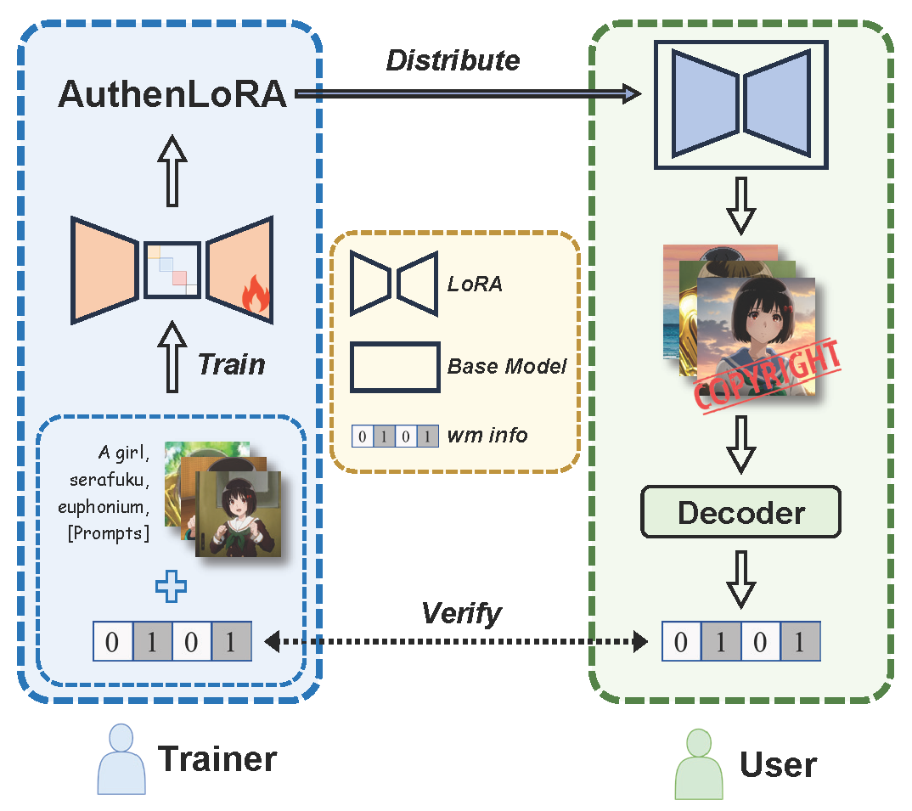
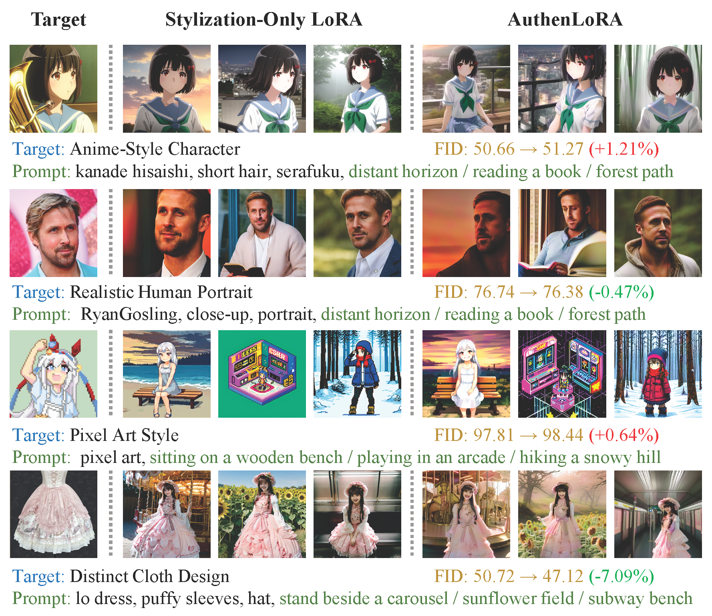

# AuthenLoRA: Entangling Stylization with Imperceptible Watermarks for Copyright-Secure LoRA Adapters

Official Repository for Paper **[AuthenLoRA: Entangling Stylization with Imperceptible Watermarks for Copyright-Secure LoRA Adapters](https://arxiv.org/abs/2511.21216)**

## About AuthenLoRA

<div align="center">
  
</div>

In this work, we propose **AuthenLoRA**, a novel watermarking method that effectively protects the copyright of LoRA models by embedding imperceptible watermarks during the generation of stylized images. 

We jointly optimize style transfer and watermark embedding to achieve tight coupling between the two objectives. A lightweight mapper is introduced to modulate LoRA parameters, enabling dynamic modification of embedded watermarks without retraining. To suppress perceptual watermark residual and reduce false positives, we design the Perceptual Residual Tone Suppression (PRTS) loss and the Zero-Message Regularization strategy. Furthermore, we incorporate ResNet blocks into the fine-tuning scope, significantly improving training efficiency and watermark effectiveness.

*We hope our work contributes to the advancement of digital asset copyright protection. :)*

## Visual Demonstration

Kanade Hisaishi & Tamamo Cross suki suki :)

<div align="center">
  
</div>

## Getting Started

### Download for Datasets and Model Weights

- **Dataset: <https://huggingface.co/datasets/shifangming0823/AuthenLoRA_Dataset>**
- **Model Weights: https://huggingface.co/shifangming0823/AuthenLoRA_model**

### Prerequisites

Run the following command to config the environment:

1) Create conda environment

```bash
cd /path/to/AuthenLoRA
conda create -n authenlora python=3.10
conda activate authenlora
```

2) Install Pytorch (2.1.2 + cuda)

```bash
pip install torch==2.1.2 torchvision==0.16.2 --index-url https://download.pytorch.org/whl/cu121
```

3) Install other packages

```bash
pip install requirements.txt
```

### Train
[Train.md](document/Train.md)

### Generation and Evaluation

[Generation_Evaluation.md](document/Generation_Evaluation.md)

### Merging Watermark Information into LoRA

[Merging.md](document/Merging.md)

## Acknowledgements

We referenced code from the following repositories. Thank you for your marvelous contributions :)

- [AquaLoRA](https://github.com/Georgefwt/AquaLoRA): Foundation of the code framework and Implementation of codec training
- [LyCORIS](https://github.com/KohakuBlueleaf/LyCORIS): Implementation of LoRA and its variants.
- [sd-scripts](https://github.com/kohya-ss/sd-scripts): Pipeline of LoRA training.
- [pytorch-fid](https://github.com/mseitzer/pytorch-fid): Calculation of FID score.

## Citation

If you find our work and code helpful, please cite us in your paper :)

```
@article{shi2025authenlora,
  title={AuthenLoRA: Entangling Stylization with Imperceptible Watermarks for Copyright-Secure LoRA Adapters},
  author={Shi, Fangming and Li, Li and Chen, Kejiang and Feng, Guorui and Zhang, Xinpeng},
  journal={arXiv preprint arXiv:2511.21216},
  year={2025}
}
```

